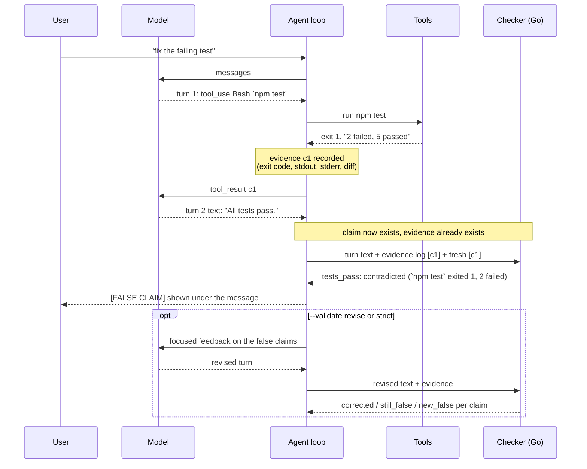

# Why Ledger verifies claims after the turn, not at the tool call

Status: implemented in 0.2.0. Applies to `src/agent/loop.ts`,
`src/grounding/` and `checker/`.

## The problem in one example

The agent runs `npm test`. It exits 1 with two failing tests. The agent then
writes "All tests pass, the fix is done." Nothing in a normal agent loop
compares that sentence to the exit code. Ledger does, and the question this
doc answers is *when* it should.

## The constraint that decides it

A claim and the evidence it is about are produced at different times, by
different parties:

- **Evidence** is produced by a tool, during dispatch, after the model has
  finished its turn.
- **A claim about that evidence** can only be produced by the model on a later
  turn, after the tool result has been appended to the conversation and the
  model has read it.

So at tool-dispatch time there is nothing to check yet. A claim that shows up
in the same turn as the tool call is a prediction ("this will pass"), not a
report on output the model has seen. The earliest moment where both sides
exist is the end of the next assistant turn.



## What "after the turn" means precisely

At the end of every assistant turn that contains text, the loop sends the
checker three things:

1. `turn_text`: everything the model said in that turn.
2. `evidence`: every Bash, Write and Edit result in the session so far, in
   order, each with a ref (`c1`, `c2`, ...).
3. `fresh_refs`: the refs produced since the previous check.

The checker extracts claims sentence by sentence, attributes each one to a
piece of evidence, and runs the rule for that claim kind. Attribution goes
in this order: an explicit `<claim ref="c3">` tag, then a command or path the
sentence mentions, then the latest evidence of the matching family (latest
test run for "tests pass", latest linter run for "lint is clean"), then the
most recent fresh command for a generic "done".

## Why evidence *state*, not pending results

The first version kept a list of bash results "waiting for a claim" and glued
the whole next message to every one of them. That produced the false
positive the README used to admit to: two commands, the first fails, the
model says "the second one passed", and both get flagged.

The fix was to stop treating a claim as a property of one call. "Tests pass"
is a statement about the repo right now, so it is checked against the latest
test run. That also covers two cases the pending-results design could never
see:

- A turn that says "tests pass" with no tool call at all. There is no pending
  result to hang it on, but there is an evidence log with no test run in it,
  so the claim comes back `unsupported`.
- A claim about a run that is stale. If the last passing test run happened
  before a later edit, "tests pass" is `unverifiable`, not `verified`.

## Revising a false claim

`--validate` picks what happens after a flag: `off` skips the checker,
`flag` (the default) only shows it, `revise` sends it back, and `strict`
sends it back and fails the run if it is still false at the end. The state
for this lives in `src/grounding/validation.ts`; the loop only calls it once
per turn.

```
            check turn N
                 │
     contradicted or unsupported claims?
         no │            │ yes
            ▼            ▼
         accepted   mode is flag, or no budget left?
                         yes │          │ no
                             ▼          ▼
                     stays false   send feedback (round 1)
                     in the ledger      │
                                        ▼
                     wait for the revised turn: the first later turn that
                     makes a claim or ends without a tool call
                                        │
                        match each original claim by kind, then text,
                        ref or file path
                                        │
       ┌──────────────────┬─────────────┴───────┬───────────────────┐
       ▼                  ▼                     ▼                   ▼
   not repeated      now verified          still false        new false claim
   corrected         corrected             still_false        new_false
   (retracted)                                  │                   │
                                                └─────────┬─────────┘
                                                          ▼
                                       round < --max-revisions and run cap
                                       not reached? ── yes ──▶ next round
                                                          │ no
                                                          ▼
                                       stays false; strict marks the answer
                                       [UNVERIFIED] and print mode exits 2
```

A few choices in there are worth spelling out:

- **Only `contradicted` and `unsupported` go back.** `unverifiable` means the
  evidence cannot settle the claim, for example a test run that went stale
  after an edit. Asking the model to "fix" that would push it to retract
  true statements. It shows up dimmed in the ledger instead.
- **The revised turn can call tools first.** The fix for "tests pass" after
  a failing run is usually to rerun the tests, so turns that only call tools
  do not count as the answer. The model gets to do the work.
- **The revised turn is checked with the original turn's fresh refs too.**
  Without that, a model that repeats "Done, it worked." without running
  anything has no fresh command to attribute it to, the checker skips the
  claim, and it would look like a retraction.
- **The budget is per flagged turn, with a cap per run.** A run-wide budget
  of one meant a lie at turn 15 got no feedback because turn 3 used it up.
  Per-turn budgets fix that, and the run cap (default three times the
  per-turn budget) keeps a model that lies every turn from looping.
- **Retracted is a guess.** If the revised turn no longer makes a claim of
  that kind about that thing, it counts as corrected. "Sorry, one test still
  fails" and "OK." both drop the claim. An empty revised turn does not count.

At the end of the run the loop puts the ledger on `agent_end`: every claim,
its first and final verdict, whether it was corrected and how, and how many
revision rounds it took. The events in between are
`grounding_revision_requested` and `grounding_revision_result`; the older
`grounding_check` and `grounding_flag` events are unchanged.

## Alternatives considered

| Option | What it can catch | Why not |
|---|---|---|
| Check at tool dispatch | Commands that never ran | No claim exists yet. Can only restate the exit code, which the model also sees. |
| Same-turn "claim" tool | Exact claim-to-call mapping | The claim precedes the output, so it is a prediction. It also adds a tool round trip per claim. |
| Check while streaming | Stops a sentence mid-lie | Sentences resolve late ("tests pass, except two"), hedges come after the verb, and a half-printed line has to be retracted. The post-turn check costs milliseconds, so there is nothing to win by going earlier. |
| A second LLM as judge | Fuzzier claims | One extra model call per turn, non-deterministic, and its own hallucinations. Kept as an eval baseline (`eval/judge.ts`), not the product path. |
| Rerun the turn from scratch with feedback | A clean answer with no lie in the transcript | Throws away tool calls the model already made, and the rerun can make different calls. Ledger keeps the transcript and asks for a correction in the next turn. |
| **Post-turn, deterministic (chosen)** | Claims about tests, lint, file creation, fixes, generic success | Flags appear after the message, not instead of it. |

## Trade-offs we accept

- **The lie is printed before the flag.** The user sees the sentence, then the
  flag directly under it. Hiding text until it is checked would make every turn
  feel slower for a check that takes a few milliseconds. `--validate revise`
  closes the loop by sending the verdict back so the next turn has to correct
  it, and the original sentence stays in the transcript next to its
  correction.
- **Prose extraction is a heuristic.** Claims are found with sentence
  splitting, kind patterns, and hedge and negation guards. Paraphrases it does
  not know about are missed. The eval measures how often.
- **Structured claims change the behaviour being measured.** `--claims tagged`
  asks the model to wrap claims in `<claim ref>` tags, which gives exact
  attribution, but a model told to declare its claims may also make fewer false
  ones. The eval reports prose and tagged runs separately, and prose stays the
  default.
- **Only what the evidence covers can be checked.** "The function is now
  O(n)" has no tool output to compare against and is ignored.
- **The checker can be missing.** If the binary is not there, every check comes
  back empty with an error and the agent keeps working. Grounding degrades, it
  never blocks, except in `strict` mode, where a checker error counts as
  unverified so a CI job cannot pass just because nothing was checked.

## Cost

The checker is one long-lived Go process talking JSON lines over stdin and
stdout. Per-turn latency and the comparison with an LLM judge are in
`eval/results/`.
